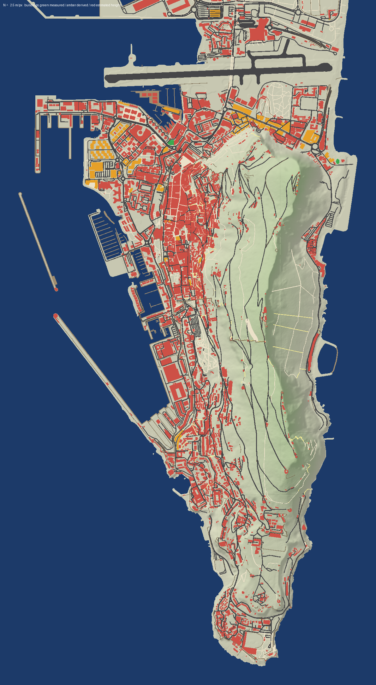

# Gibraltar: a 1:1 walking simulator

A peaceful first-person walk through the whole territory of Gibraltar, rebuilt
at true scale from real geographic data. The Rock, the town, the roads, about
2,400 Gibraltar buildings (plus La Línea across the border for context), the
harbour and the beaches are all where they really are.



## What's in this folder

| Folder | What it is | Status |
|---|---|---|
| `web/` | **Browser walker.** Walk the build in Chrome, Edge or Firefox. | Working and tested (24 automated checks) |
| `Unreal/Gibraltar/` | **Unreal Engine 5 project**: the real game. | Written, **not yet compiled**: needs UE 5.5 on your PC. See its README. |
| `pipeline/` | Python tools that turn open map data into the 3D world. | Working |
| `data/build/` | The built world: 68 tiles of 500 m × 500 m. | Built 2026-10-29, validation passing |
| `docs/` | How it all works, where the data comes from, what's still wrong. | |

## Walk it now (browser)

You need [Node.js](https://nodejs.org) 18 or newer. From the repository folder:

```bash
node gibraltar/web/serve.mjs
```

Then open **http://127.0.0.1:8080/web/** and click to start. You begin in
Grand Casemates Square.

| Key | Action |
|---|---|
| Mouse | Look around |
| W A S D | Walk |
| Shift | Run |
| Space | Jump |
| C | Crouch |
| E | Inspect a building, tree or landmark: shows its source and how accurate it is |
| V | Colour buildings by how accurate their height is (green measured, amber derived, red estimated) |
| M | Show or hide landmark markers |
| F3 | Location readout (coordinates, height, tile) |
| `[` / `]` | Time of day back or forward an hour |
| T | Pause or resume time |
| Esc | Menu: settings, save or load your position, teleport to a landmark, credits |

## How accurate is it?

Accuracy is measured, not assumed. See `docs/VALIDATION.md`, regenerated on
every build:

- **Scale:** distances in the game match real distances on the Earth's
  surface to within 0.14 parts per million.
- **Coastline:** Gibraltar's land area comes out at 6.591 km², against the
  official 6.55 km² (+0.6%, consistent with recent reclamation).
- **Terrain:** Spain's 5 m terrain model, with matching tile edges; the
  summit is about 9 m too low.
- **Roads:** every road and path is in its OpenStreetMap position.

What's **approximate**, and labelled as such in the data:

- **Building heights:** about 97% are estimated, because almost none are
  recorded in open data.
- **Windows, most doors, balconies and shutters:** generated from documented
  rules in Gibraltar's styles, not surveyed building by building.
- **Street furniture and trees:** generic models, though at their real mapped
  positions.

The full list, largest problems first, is `docs/DISCREPANCIES.md`.

## Making it more accurate

The single biggest improvement would come from HM Government of Gibraltar's
own GIS data: building heights, footprints, terrain and aerial photos. That
needs **written permission**. A ready-to-send email is in `docs/LICENSING.md`,
section 6.

You can also correct individual buildings yourself:

- `data/facade_overrides.json`: record the real balconies and shutters of a
  building.
- `data/overrides.json`: replace a building with a hand-made model.

Then rebuild (see `pipeline/README.md`).

## Credits

Map data © OpenStreetMap contributors (ODbL). Terrain: "Obra derivada de
MDT05-cob1 2008-2015 CC-BY 4.0 scne.es" (Instituto Geográfico Nacional,
Spain). Contains modified Copernicus Sentinel data 2026. three.js (MIT).
Full licensing obligations: `docs/LICENSING.md`. The derived world data in
`data/` is offered under the ODbL; see `data/DATA_LICENCE.md`.
